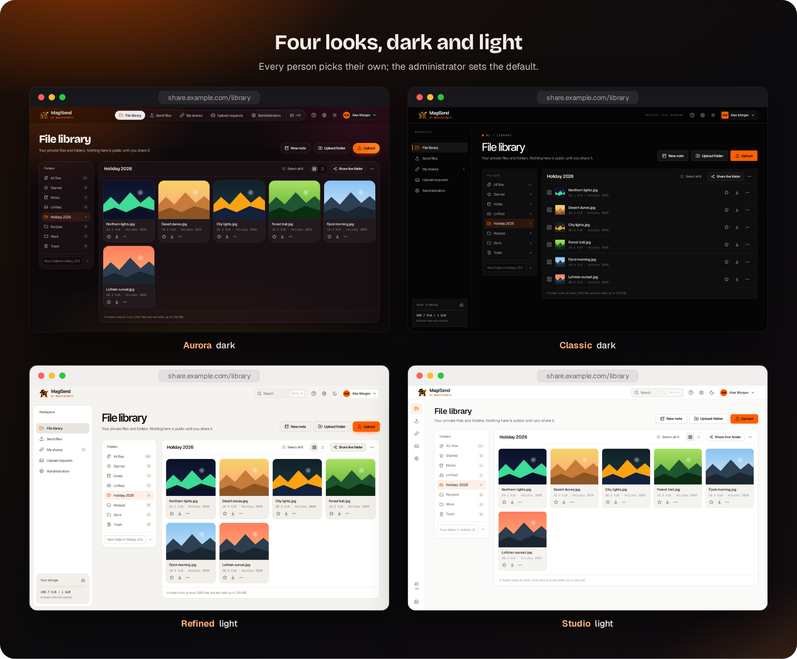
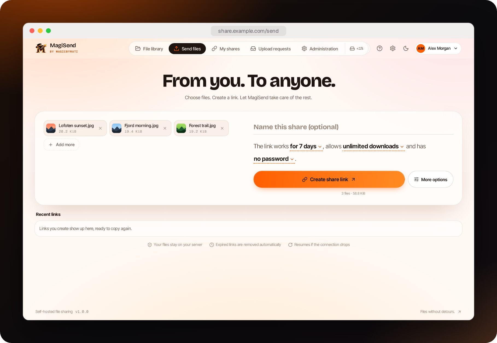
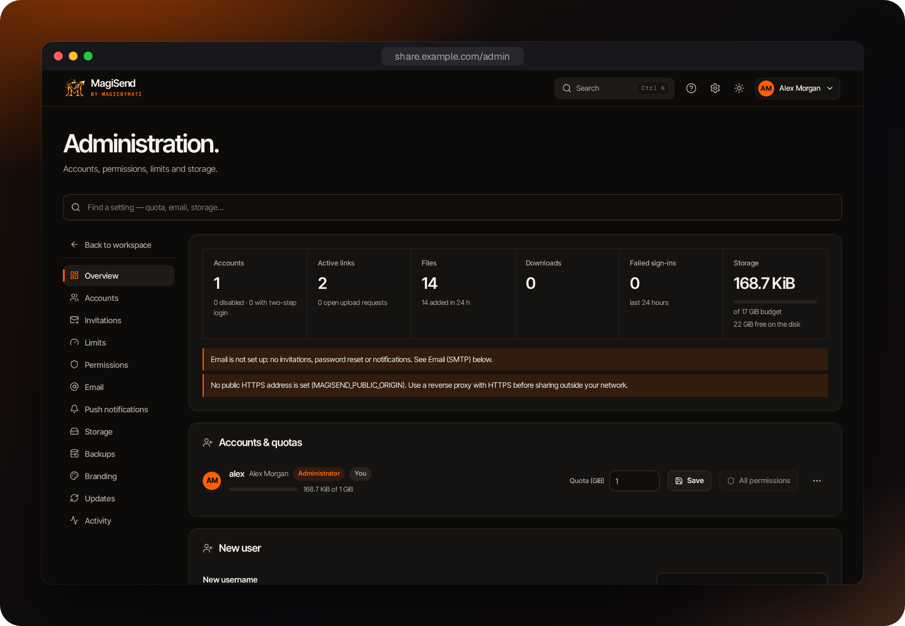
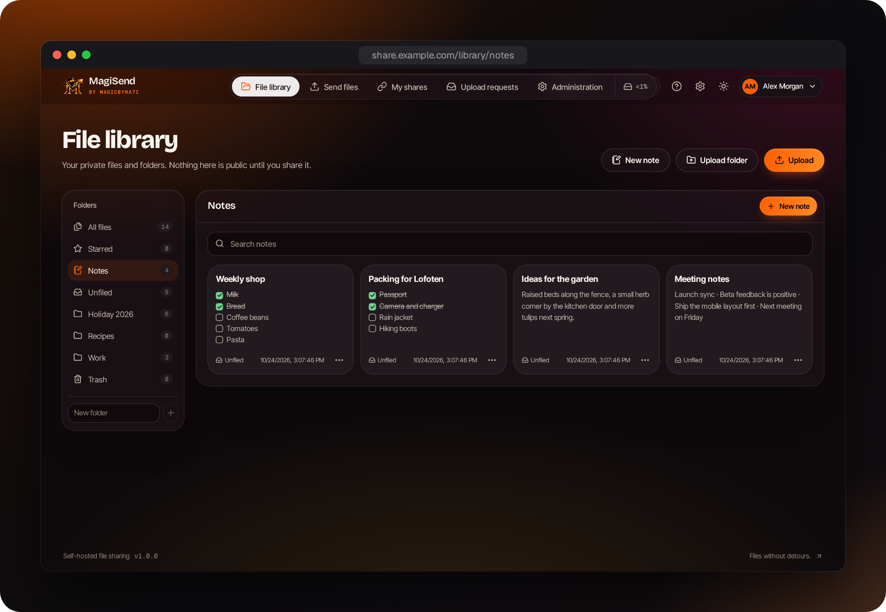
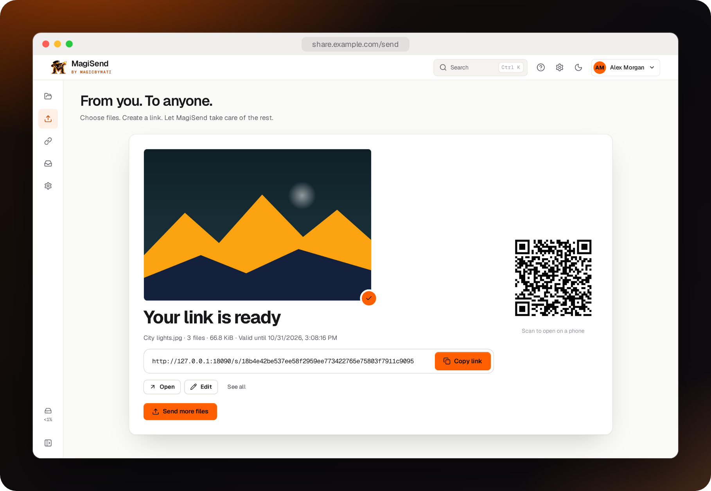

<p align="center">
  
</p>

<h1 align="center">MagiSend</h1>

<p align="center">
  Private, self-hosted file sharing by <strong>MagicByMati</strong>.<br />
  Upload, share a link, keep a private library — on your own server.
</p>

<p align="center">
  <a href="https://github.com/Mati-l33t/magisend/releases/latest"></a>
  <a href="LICENSE"></a>
  
</p>

<p align="center">
  
</p>

## Features

**Sharing**
- **Share links** with optional password, expiry or no expiry, custom link name, description and QR code — all changeable after sending. Recipients download single files or everything as one ZIP.
- **Link previews in chat apps** — a shared link shows its title, file count and first picture in Discord, Slack, Messenger and similar apps.
- **Download limits** — let each file be downloaded once or a set number of times, then the link closes by itself. See per-file download counts.
- **Expiry reminders** — get an email before a link expires and keep it open with one click.
- **Gallery and slideshow** — recipients step through pictures, videos, PDFs and text with the arrow keys or play a slideshow.
- **Remove photo location** — strip GPS coordinates and camera serial numbers from photos before they are shared.
- **Upload requests** — send someone a link and they can upload files straight into a folder of your library, optionally password-protected, without an account.

**Library**
- **Private library** with nested folders and starred files. Nothing is public until you share it. Share a folder live (it follows the folder) or a fixed selection.
- **Resumable uploads** of files or whole folders — a dropped connection is retried on its own, and an interrupted upload continues where it stopped.
- **Notes** — write Markdown notes with checklists, autosave and history, keep them in folders and share them as a clean reading page.
- **Versions** — replace a file with a new version while every link keeps working; earlier versions can be opened and restored.
- **Trash** — deleted files stay restorable for 30 days.
- **Unpack ZIP and tar files** (`.zip`, `.tar`, `.tar.gz`, `.tgz`, `.tar.bz2`) into a folder of the library.
- **Previews** — images, PDF documents (rendered in the app, scripts never run), Word and Excel files, video, audio, Markdown and source code with highlighting, recognised by content, not file name.
- **Text editing** for plain-text files up to 256 KiB, with version history and restore.

**People and notifications**
- **Collaboration** — let named, signed-in people edit text files, add files or delete files in what you share. Every right is off until both the administrator and the sender allow it.
- **Email** — send links by email and get notified when files are downloaded (any SMTP provider).
- **Push notifications** to ntfy, Gotify, Discord or any webhook when files are downloaded or uploaded.
- **Invitations and password reset by email** — invite people even when registration is closed; users can reset a forgotten password themselves.
- **Two-step login** with any authenticator app, plus one-time recovery codes.
- **API tokens** — upload from ShareX, scripts or curl and get a share link back; a ready-made ShareX config is one click away.

**Running it**
- **Administration** — an overview dashboard, an activity log, accounts, quotas, storage budget, permissions, and **updates from the web interface** with automatic rollback.
- **Optional virus scanning** with ClamAV: new files, or only files received from others, are held back until they are scanned, and files with a virus are blocked.
- **Built-in backups** — daily or weekly backups of the database and files, kept and downloadable from the web interface.
- **Storage on a NAS or second disk** — keep files on a mounted network share (SMB/CIFS, NFS) or another disk, chosen in the web interface. Move existing files there and back with one click; every copy is checked.
- **Installable app (PWA)** on phones, tablets and desktops — including sharing files straight from the phone's share menu.
- **Your own branding** — name, accent color and logo for the whole interface, public pages and emails. Four looks, dark and light.
- **English and Swedish.** Adding a language is a single file.
- **Lightweight** — one program with SQLite built in, a 7 MB download. MagiSend uses about 20 MB of memory and no CPU while idle; a complete Proxmox container runs it in about 60 MB of RAM and 800 MB of disk.
- **Private** — no telemetry and no tracking. Your files never leave your server; the only outside contacts are the update check (which can be turned off) and email or push notifications you set up yourself.

<p align="center">
  
</p>
<p align="center">
  
  
</p>
<p align="center">
  
</p>

<details>
<summary><strong>More screenshots</strong></summary>
<br />
<p align="center">
  
</p>
<p align="center">
  
  
</p>
</details>

## Install

### Proxmox VE (LXC)

Run on your **Proxmox host** as root:

```sh
bash <(curl -fsSL https://raw.githubusercontent.com/Mati-l33t/magisend/main/proxmox/install.sh)
```

It creates an unprivileged Debian LXC (default 1 core, 512 MB RAM, 4 GB disk, DHCP) and installs MagiSend in it. Uploaded files are stored on that disk unless you add a NAS share; the disk can be grown later in Proxmox, after which you raise the storage budget under **Administration → Limits**. The container's Notes panel links to the project, and signing in to the container shows its address and how to update. In the default install the container's console signs in as root without a password; choose **Advanced** to set a root password instead. Choose **Advanced** to set the container ID, hostname, disk, CPU, RAM, bridge, static IP, VLAN, root password, port and a public address for a reverse proxy, and to add virus scanning with ClamAV (which raises the memory to at least 2560 MB).

### Debian, Ubuntu and other Linux systems

Run as root on a systemd-based system (amd64 or arm64), including an existing LXC or VM:

```sh
curl -fsSL https://raw.githubusercontent.com/Mati-l33t/magisend/main/install.sh | bash
```

Optional settings, for example `MAGISEND_PORT=9000 MAGISEND_PUBLIC_URL=https://share.example.com`, can be put in front of `bash`. MagiSend is installed in `/opt/magisend`, stores data in `/var/lib/magisend` and runs as the unprivileged `magisend` user in a hardened systemd service.

### Docker

```sh
curl -fsSL https://raw.githubusercontent.com/Mati-l33t/magisend/main/docker-compose.yml -o docker-compose.yml
docker compose up -d
```

The image `ghcr.io/mati-l33t/magisend` is built for amd64 and arm64, runs as a non-root user and keeps all data in the `magisend_data` volume.

After installing, open `http://<server>:8080` and create the administrator account with the **setup code** the installer printed, so nobody else on the network can claim a fresh installation. The code is also in the server log (`journalctl -u magisend`; Docker: `docker compose logs magisend`) and in the file `setup-code` in the data folder until the account exists. Automated setups can choose it with `MAGISEND_SETUP_CODE`.

## Reverse proxy and HTTPS (Nginx Proxy Manager)

Use HTTPS whenever MagiSend is reachable from outside your home network; it is also required for installing the app on phones.

1. In Nginx Proxy Manager add a **Proxy Host**: your domain, scheme `http`, the MagiSend server's IP and port `8080`. Enable *Block Common Exploits*.
2. On the **SSL** tab request a Let's Encrypt certificate and enable *Force SSL*, *HTTP/2* and *HSTS*.
3. Nothing is needed on the **Advanced** tab. Uploads are sent in 4 MiB pieces, which fit Nginx Proxy Manager's default limits. If you use NPMplus with its CoreRuleSet (web application firewall) turned on, turn it off for this host: it blocks the requests MagiSend uses to edit, move and delete files.

4. Tell MagiSend about the proxy in `/etc/magisend/environment` (Docker: the `environment` section of `docker-compose.yml`) and restart it:

   ```sh
   MAGISEND_PUBLIC_ORIGIN=https://share.example.com
   MAGISEND_TRUSTED_PROXIES=192.168.1.20   # the Nginx Proxy Manager address
   ```

   ```sh
   systemctl restart magisend      # Docker: docker compose up -d
   ```

With plain Nginx or another proxy, allow request bodies of at least 8 MB; see [docs/operations.md](docs/operations.md).

## Updating

MagiSend checks GitHub for new releases. Administrators see a notice with the new version and a link to the changelog, and can update under **Administration → Updates**.

Every release is signed with a key that is kept off GitHub, and the installed MagiSend checks that signature before it updates, so a taken-over GitHub account or download cannot push an update to a native installation. Only newer versions are installed. Before switching, MagiSend saves its database and snapshots the files in its data folder (with hard links, when they share a disk with `/var/lib`); if anything goes wrong, the update is stopped, or the new version does not start, the previous version and database are put back and started again. Files on added storage locations (a NAS) are not part of that snapshot; stored files are never changed in place. Docker images are only built from releases after they were signed and published; the images themselves are not signed. To check a release by hand, see [docs/operations.md](docs/operations.md#release-signatures).

- **Proxmox LXC / Linux:** use the button, or run `/opt/magisend/update.sh` as root.
- **Docker:** `docker compose pull && docker compose up -d`.

## Configuration

| Setting | Default | Purpose |
|---|---|---|
| `MAGISEND_LISTEN` | `0.0.0.0:8080` | Address and port to listen on. |
| `MAGISEND_PUBLIC_ORIGIN` | — | Public `https://` address behind a reverse proxy. Enables Secure cookies and HSTS. |
| `MAGISEND_TRUSTED_PROXIES` | — | Comma-separated IPs or CIDR ranges of your reverse proxies. |
| `MAGISEND_DATA` | `/var/lib/magisend` | Database and file storage. |
| `MAGISEND_UPDATE_CHECK` | `true` | Set to `false` to never contact GitHub for update checks. |

Storage budget, quotas, size limits, default expiry, registration and permissions are set in the web interface. New installations start with a storage budget of three quarters of the disk.

## Storing files on a NAS or another disk

File contents can live on a mounted network share or a second disk, while the database stays in the data folder. Mount the share on the system, then add its folder under **Administration → Storage locations** and choose **Use for new files**. Existing files can be moved there, and back, with **Move all files here**; each copy is read back and compared before the original is removed.

- **Proxmox LXC:** mount the share on the Proxmox host (for example in `/etc/fstab` with `nofail,x-systemd.automount`) and pass it into the container with `pct set <id> -mp0 /mnt/share-on-host,mp=/mnt/share`. In an unprivileged container the share must be writable by the app's user as the host sees it, which is 100000 plus its id inside the container; the storage page shows the exact ids and an example line.
- **Debian, Ubuntu:** mount anywhere under `/mnt`, `/media` or `/srv` — the service may write there.
- **Docker:** mount the share into the container, e.g. add `- /mnt/nas/magisend:/mnt/share` under `volumes`, and add `/mnt/share`.

Stored files are named by random IDs; their names, owners and folders are in the database, and each storage folder also keeps a small index (`.magisend-index.json`) of them. A file the database does not know, for example after restoring an older backup, is never deleted straight away: it is set aside in an `.unclaimed` folder for 30 days and listed under **Administration → Storage**, where one click puts it back into its owner's library, in its old folder and with its old name.

The app keeps its files in a folder named `magisend-files` inside the chosen folder and checks every few seconds that it is reachable. If the share is unmounted or the NAS is off, that folder is missing: downloads and uploads of files stored there pause with a clear message, while signing in, browsing the library, links and settings keep working. Nothing is written to the local disk by mistake, and everything works again by itself when the share is back. Use SMB/CIFS rather than NFS with a default `hard` mount, which can freeze processes when the server disappears.

## Virus scanning (optional)

MagiSend can check new files with [ClamAV](https://www.clamav.net). ClamAV runs as its own service and needs about **1.5 GB of memory** (give the machine at least 2.5 GB in all), so it is off unless you add it. **Administration → Virus scanning** shows whether ClamAV runs, and on an installation made with the installer it has an **Install ClamAV** button, so it can be added at any time later. Otherwise:

- **Debian, Ubuntu:** put `MAGISEND_WITH_CLAMAV=1` in front of `bash` in the install command (it also works on an existing installation), or install `clamav-daemon` yourself and set `StreamMaxLength 100M`, `MaxFileSize 100M`, `MaxScanSize 400M`, `PCREMaxFileSize 100M` and `AlertExceedsMax true` in `/etc/clamav/clamd.conf` (Debian stops at 25 MB; with `AlertExceedsMax` a file ClamAV could not scan whole is marked unscanned instead of clean).
- **Proxmox LXC:** answer yes to **Virus scanning** in the installer's **Advanced** settings. For an existing container, give it at least 2.5 GB of memory, then run the Debian command above inside it.
- **Docker:** remove the `#` in front of the `clamav` service, the `clamav_db` volume and `MAGISEND_CLAMAV` in `docker-compose.yml` and start again. The ClamAV image scans files up to 100 MB but leaves `AlertExceedsMax` off, so an archive too large for it to unpack whole can count as clean; to change that, copy the image's own `/etc/clamav/clamd.conf` out of the container, add the line `AlertExceedsMax true`, and mount that copy back over `/etc/clamav/clamd.conf` (a file with only that line would drop the image's other settings, such as the port MagiSend connects to).

Then switch it on under **Administration → Virus scanning**, for all new files or only files received through upload requests and shared links. Uploads are not slowed down: a file is scanned right after it is stored and cannot be downloaded until then, which usually takes a few seconds. A file in which a virus is found stays blocked for everyone until its owner deletes it, and the owner can be told through push notifications. Files stored before scanning was switched on are not scanned. If ClamAV stops answering, new files wait and the administration page says why; switching scanning off releases them.

## Backups

All data lives in `/var/lib/magisend` (Docker: the `magisend_data` volume). Stop MagiSend and copy the whole directory to back it up; see [docs/operations.md](docs/operations.md). Files kept on an added storage folder are not in that directory: back that folder up too, from about the same time.

## Development

Requirements: Go 1.27+, Node.js 24+.

```sh
cd web && npm ci && npm run build && cd ..
MAGISEND_DATA=./data go run .             # http://localhost:8080
```

```sh
go test ./... && go vet ./...
cd web
npm test && npm run check:locales && npm run format:check
npm run e2e                               # browser tests on disposable servers
```

Release archives and the Docker image are built by GitHub Actions when a `v*.*.*` tag is pushed; `scripts/build-release.sh v1.2.3` builds them locally with Docker. Translations: see the [translation guide](web/translation-guide.md).

## Security

Please report vulnerabilities privately — see [SECURITY.md](SECURITY.md).

## License

[MIT](LICENSE) © MagicByMati
